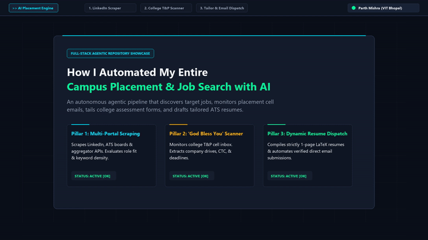

<div align="center">


<a href="https://github.com/parthmishra9942">
  
</a>

<br><br>

<a href="https://ai-portfolio-beige-xi.vercel.app/"></a>
<a href="https://linkedin.com/in/parth-mishra-4b7578242"></a>
<a href="https://leetcode.com/u/parth213g/"></a>
<a href="mailto:parthmishra9942@gmail.com"></a>

<br><br>


</div>

---

## ⚡ Engineering Philosophy

```
                    ┌───────────────────────────────────────────────┐
                    │               PARTH MISHRA                    │
                    │   Final-Year B.Tech CSE (AI/ML) · Batch 2027  │
                    │          VIT Bhopal University (CGPA 8.67)    │
                    └───────────────────────┬───────────────────────┘
                                            │
           ┌────────────────────────────────┼────────────────────────────────┐
           ▼                                ▼                                ▼
┌────────────────────────┐      ┌────────────────────────┐      ┌────────────────────────┐
│ 🧠 AI & Agentic Core   │      │ ⚡ Systems & Low-Level │      │ 🌐 High-Scale Product  │
├────────────────────────┤      ├────────────────────────┤      ├────────────────────────┤
│ • Autonomous Agents    │      │ • In-Memory Vector DBs │      │ • React, Next.js, Vite │
│ • Multi-Agent Loops    │      │ • HNSW Skip-Graph Math │      │ • FastAPI / Node.js    │
│ • Claude & OpenAI APIs │      │ • Custom Cosine Kernels│      │ • PostgreSQL, Supabase │
│ • RAG & Embeddings     │      │ • Network DPI Analyzers│      │ • 100% Client-Side PWA │
└────────────────────────┘      └────────────────────────┘      └────────────────────────┘
```

---

## 🚀 Featured Flagship Projects

### 1. 🥗 [AIMealTracker](https://github.com/parthmishra9942/Ai-Meal-Tracker) — AI Nutrition for Indian Vegetarian Food

> **The Problem:** Western trackers force you into US packaged barcodes and choke on *"2 roti, dal tadka, paneer sabzi"*.  
> **The Solution:** Natural-language nutrition engine powered by Claude 3.5 Sonnet, calibrated for authentic Indian home-cooking portions with sub-second macro calculation.

<div align="center">
  <a href="https://github.com/parthmishra9942/Ai-Meal-Tracker">
    
  </a>
  <br>
  <a href="https://github.com/parthmishra9942/Ai-Meal-Tracker/blob/main/media/brag.mp4"></a>
  <a href="https://github.com/parthmishra9942/Ai-Meal-Tracker"></a>
</div>

```
[User Text: "2 roti, dal, sabzi"] ──> [Claude 3.5 Sonnet Parser] ──> [Portion & Macro Vector Engine] ──> [Reactive Client UI]
```

---

### 2. ⚡ [VectorDB-Python](https://github.com/parthmishra9942/vectordb-python) — In-Memory HNSW Vector Database from Scratch

> **The Breakthrough:** High-performance vector database engineered entirely in Python with zero third-party database dependencies. Implements multi-layer HNSW graph indexing for sub-15ms top-$k$ nearest neighbor retrieval across 50,000+ embeddings.

<div align="center">
  <a href="https://github.com/parthmishra9942/vectordb-python">
    
  </a>
  <br>
  <a href="https://github.com/parthmishra9942/vectordb-python/blob/main/media/launch_video.mp4"></a>
  <a href="https://github.com/parthmishra9942/vectordb-python"></a>
</div>

```
Layer 2 (Highway Entry)  ○ ───────────────────────────────> ○ (Skip links)
                            │                                  │
Layer 1 (Medium Density) ○ ──────────> ○ ─────────────────> ○ ──────────> ○
                            │             │                    │             │
Layer 0 (Dense Space)    ○ ─── ○ ─── ○ ─── ○ ─── ○ ─── ○ ─── ○ ─── ○ ─── ○ (Base vectors)
```

---

### 3. 🛒 [VoiceCart](https://github.com/parthmishra9942/voicecart) — Privacy-First On-Device Voice Shopping Assistant

> **The Innovation:** Most voice shopping assistants upload unencrypted audio to cloud surveillance. VoiceCart executes 100% on-device speech transcription and deterministic rule-based NLU in the browser, powered by three algorithmic recommendation engines (Reorder, Seasonal, and Substitute).

<div align="center">
  <a href="https://github.com/parthmishra9942/voicecart">
    
  </a>
  <br>
  <a href="https://github.com/parthmishra9942/voicecart/blob/main/media/launch_video.mp4"></a>
  <a href="https://github.com/parthmishra9942/voicecart"></a>
</div>

```
[Microphone Audio] ──> [Browser Web Speech API] ──> [Deterministic NLU Tokenizer] ──> [Tri-Engine Rec Mesh] ──> [Offline PWA]
```

---

### 4. 🤖 [Forge Career Engine](https://github.com/parthmishra9942/my-job-search) — Autonomous Multi-Agent Placement Pipeline

> **The Engine:** Autonomous daemon operating round-the-clock on background cron schedules. Scrapes fresh openings across platforms, filters strictly for 0-YOE tech criteria, executes headless Playwright Easy Apply flows, monitors college IMAP mailboxes, and automatically routes between tailored AI vs Full-Stack resumes.

<div align="center">
  <a href="https://github.com/parthmishra9942/my-job-search">
    
  </a>
  <br>
  <a href="https://github.com/parthmishra9942/my-job-search/blob/main/media/showcase.mp4"></a>
  <a href="https://github.com/parthmishra9942/my-job-search"></a>
</div>

---

## ⚙️ Core Technical Arsenal

<p align="center">
  
</p>

| Domain | Technologies & Frameworks |
| :--- | :--- |
| **Languages** | Python, C++, TypeScript, JavaScript, SQL, HTML5/CSS3 |
| **AI / Machine Learning** | PyTorch, TensorFlow, OpenCV, Anthropic Claude API, OpenAI API, LangGraph, Ollama, HNSW |
| **Frontend Engineering** | React 18/19, Next.js, Vite, Tailwind CSS, React Native (Expo), PWA Service Workers |
| **Backend & Systems** | FastAPI, Node.js, Express, Flask, PostgreSQL, Supabase, MongoDB, SQLite, RESTful APIs |
| **Infrastructure & Tools** | Linux CLI, Git, GitHub Actions, Docker, Playwright, FFmpeg, XeLaTeX |

---

## 📊 Performance & Analytics

<div align="center">


<br>


<br>


<br>


</div>

---

<div align="center">
  <sub>Designed & engineered with precision by <b>Parth Mishra</b> · Built to inspire and ship production code.</sub>
</div>
